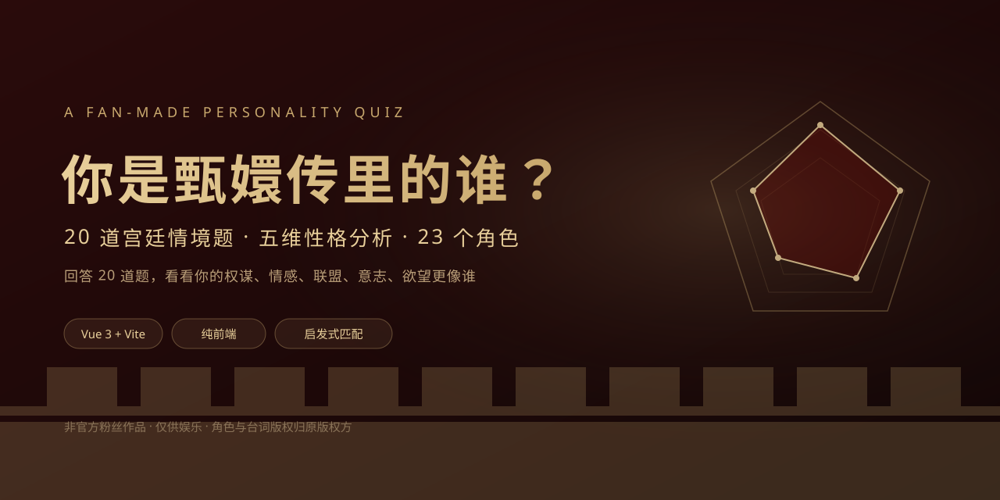
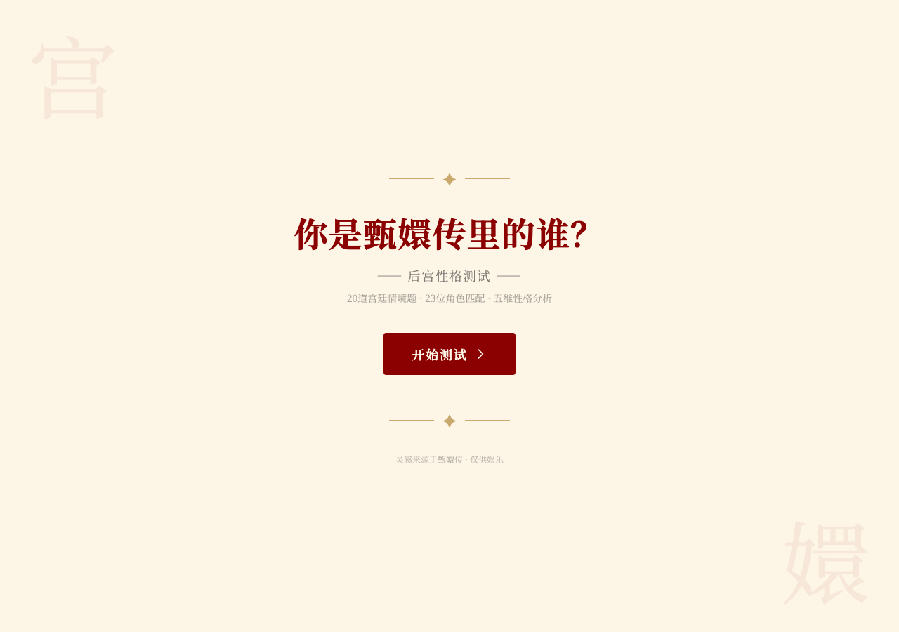

<p align="center">
  <a href="https://echozmecin-commits.github.io/zhenhuan-mbti/">
    
  </a>
</p>

<h1 align="center">你是甄嬛传里的谁？</h1>

<p align="center">
  20 道宫廷情境题，按 5 个自建维度计分，从 23 个角色里匹配一个最接近的结果。
  <br />
  纯前端、无后端、答完即出结果，可复制结果和链接分享。
</p>

<p align="center">
  <a href="https://echozmecin-commits.github.io/zhenhuan-mbti/"><strong>在线体验</strong></a> ·
  <a href="#快速开始">快速开始</a> ·
  <a href="#匹配模型">匹配模型</a> ·
  <a href="#license">License</a>
</p>

<p align="center">
  
  
  
  
</p>

> **非官方粉丝作品**：甄嬛传角色名、设定和台词版权归原版权方所有；本项目与版权方无关，仅供娱乐。

## 玩法

1. 进入开始页，点击「开始测试」；
2. 依次回答 20 道宫廷情境题，每题 3 个选项；
3. 系统累计 P/E/A/W/D 五个维度的分数；
4. 用形状相似度匹配 23 个角色，取最接近的一个；
5. 结果页展示角色、五维雷达图、性格解读、经典台词、生存指南、相似角色和分享按钮。

## 功能

- **20 道题、5 个维度**：权谋（P）、情感（E）、联盟（A）、意志（W）、欲望（D），每个维度 4 题。
- **23 个角色**：从甄嬛、华妃、皇后到沈眉庄、安陵容、果郡王等。
- **结果可视化**：用户 vs 角色的五维雷达图、五维得分条。
- **可分享**：优先调用系统分享，失败时复制结果文本 + 当前链接。
- **纯前端**：答题数据只存在内存里，不上传后端；页面会请求 Google Fonts（可自行替换为本地字体）。
- **响应式**：桌面和手机都能完成测试。

## 截图

<p align="center">
  
</p>

## 快速开始

需要 Node.js `^20.19.0 || >=22.12.0`（Vite 8 的要求）。

```bash
npm install
npm run dev
```

构建与本地预览：

```bash
npm run build
npm run preview
```

`dist/` 是构建产物，已提交一份方便直接部署；日常开发以 `src/` 为准。GitHub Pages 从 `docs/` 构建，`docs/` 里放的是 `dist/` 的副本；改完源文件后跑 `npm run build`，再把 `dist/` 同步到 `docs/`（保留 `docs/images/`）。

## 匹配模型

这是一个**娱乐性启发式模型，不是严格 MBTI，也不是心理学测评**。

- 每个维度 4 题，单题得分 1–3，所以用户单维总分范围是 4–12。
- 早期版本用原始曼哈顿距离，会被“答题强度”影响：总分高的角色更容易被匹配到，23 个角色的分布很不均衡。
- 现在改为**形状距离**：先减去各自五维均值，再计算 `1 - Pearson 相关系数`，只比较“哪一维相对更高”，不比较绝对分数高低。
- 全平答案（五维分数相同）没有形状可比，回退到原始距离。
- 距离相同时用原始距离做二次排序；仍相同则按角色数据顺序取第一个。

因此 README 里说“匹配最接近的角色”，不承诺“每个角色都同样容易测到”。23 个角色是结果池，不是均匀分布。

## 项目结构

```text
.
├── src/
│   ├── components/       # StartPage / QuestionPage / ResultPage / ProgressBar
│   ├── data/             # 20 道题、23 个角色、维度标签
│   ├── utils/matching.js # 计分 + 形状距离匹配
│   ├── App.vue           # 页面状态机
│   └── style.css         # Tailwind 主题与全局样式
├── public/favicon.svg
├── docs/images/cover.svg
├── dist/                 # 构建产物
├── index.html
└── LICENSE
```

## 已知限制

- 题库和角色向量是手工编写的，没有经过心理测量学验证；结果仅供娱乐。
- “角色代号”是角色数据里的展示字段，不是可推导的 MBTI 类型，页面已标注「非严格 MBTI」。
- “气质相近的角色”是编辑精选，不是用匹配算法实时计算出来的。
- 部分台词为化用/概括，不保证逐字对应原剧；引用时请以原剧为准。
- 刷新页面会丢失答题进度；当前没有做本地存档。
- 页面依赖 Google Fonts；在中国大陆网络下可能加载较慢，可替换为本地字体。

## Roadmap

- [x] 20 题 / 5 维 / 23 角色
- [x] 雷达图 + 五维得分 + 分享链接
- [x] 形状距离匹配，降低“高分角色霸榜”
- [ ] 答题进度本地存档 / 恢复
- [ ] 选项顺序随机化，降低一路选 C 的偏差
- [ ] 角色插画/印章与角色图鉴
- [ ] Vitest 测试：计分、匹配、平票、角色可达性
- [ ] GitHub Actions 自动构建并部署 Pages

## License

代码使用 [MIT License](LICENSE)。甄嬛传角色名、设定与台词版权归原版权方；本项目为非官方粉丝作品，不构成任何官方关联。
